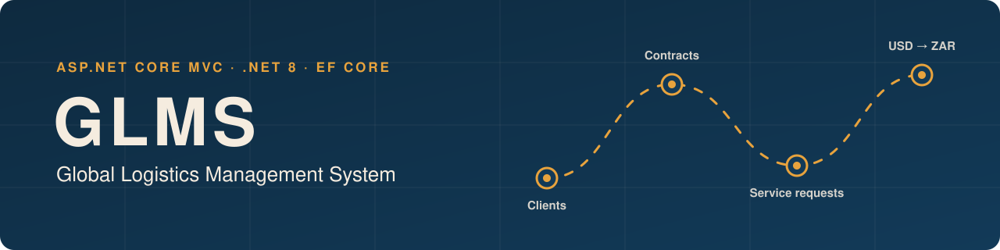
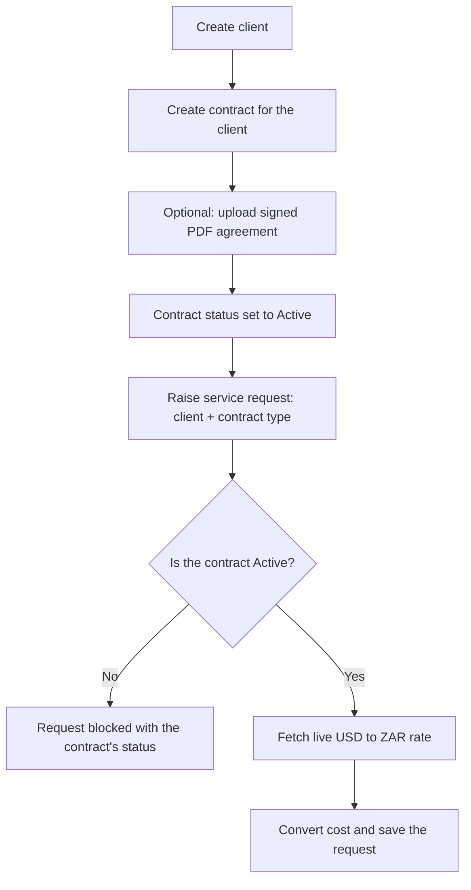
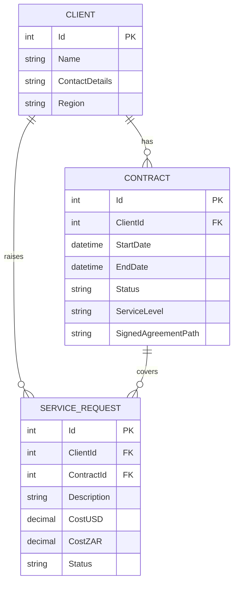

<a id="top"></a>

<p align="center">
  
</p>

# GLMS — Global Logistics Management System

**A centralised web platform for managing logistics clients, contracts and service requests.**

GLMS is an ASP.NET Core MVC application built for the fictional company TechMove Logistics. It replaces a spreadsheet-based process with one system for clients, contracts, signed agreements and service requests, including live USD to ZAR currency conversion.

<p align="left">
  
  
  
  
  
  <a href="https://github.com/jarrudcochrane/global-logistics-management-system/actions/workflows/dotnet.yml"></a>
</p>

**[🚀 Get started](#setup-and-run) · [✨ Features](#features) · [🧩 Design patterns](#design-patterns) · [🧪 Tests](#unit-tests) · [🎬 Demo video](#demo-video)**

<a id="problem-and-solution"></a>

## The problem and the solution

| The problem | The GLMS solution |
| :--- | :--- |
| Client and contract records live in separate spreadsheets that are hard to keep consistent. | Clients, contracts and service requests are stored in one SQL Server database with enforced relationships. |
| Signed agreements are kept apart from the contracts they belong to. | Each contract can carry an uploaded PDF agreement that is stored on the server and downloadable from the contract. |
| Work can be requested against contracts that are no longer valid. | A service request can only be raised against a contract whose status is **Active**. |
| Costs are quoted in USD but need to be tracked in ZAR. | The USD cost is converted to ZAR with a live exchange rate when the request is saved. |

| 🧑‍💼 Clients | 📑 Contracts | 🛠️ Service requests | 💱 Currency |
| :--- | :--- | :--- | :--- |
| Create, view and delete clients with contact details and region. | Track status and service level, attach a signed PDF, filter by status and date. | Raise requests against a client's active contract. | Convert USD to ZAR using a live rate, with a fallback. |

<a id="demo-video"></a>

## 🎬 Demo video

| Walkthrough | Link |
| :--- | :--- |
| **GLMS application demonstration** | https://www.youtube.com/watch?v=4XygpvuMjr0 |

---

## 🧭 Table of contents

| Area | Sections |
| :--- | :--- |
| **Overview** | [Problem & solution](#problem-and-solution) · [Demo video](#demo-video) · [Technology stack](#technology-stack) |
| **Application** | [Features](#features) · [Application flow](#application-flow) · [Data model](#data-model) · [Design patterns](#design-patterns) |
| **Setup & running** | [Requirements](#requirements) · [Setup and run](#setup-and-run) · [Manual database script](#database-script) |
| **Quality** | [Unit tests](#unit-tests) · [Continuous integration](#continuous-integration) · [Known limitations](#known-limitations) |
| **Resources** | [Project structure](#project-structure) · [References](#references) · [About](#about) · [Licence](#license) |

---

<a id="technology-stack"></a>

## 🛠️ Technology stack

| Technology | Purpose |
| :--- | :--- |
| ASP.NET Core MVC (.NET 8) | Web application framework: controllers, Razor views and routing |
| Entity Framework Core 8 | Object-relational mapping and database migrations |
| SQL Server / LocalDB | Persistent application database |
| HttpClient | Calls the exchange-rate API |
| Newtonsoft.Json | Parses the exchange-rate API response |
| Bootstrap and jQuery Validation | Layout, styling and client-side form validation |
| NUnit | Unit testing |
| GitHub Actions | Builds the solution and runs the tests on every push and pull request to `main` |

---

<a id="features"></a>

## ✨ Features

### 🧑‍💼 Client management

- Create, view and delete clients.
- Each client stores a name, contact details and a region.
- All three fields are required and validated.

### 📑 Contract management

- Create contracts linked to a client, with start and end dates.
- Status tracking: **Draft**, **Active**, **Expired** and **On Hold**.
- Service levels: **Basic**, **Standard** and **Enterprise**.
- Upload a signed PDF agreement per contract. Only `.pdf` files are accepted, and each file is saved under a unique generated name.
- Download the signed agreement from the contract.
- Filter the contract list by status and date range using LINQ.

### 🛠️ Service request processing

- Raise a service request by choosing a client and a contract type.
- The system finds that client's contract of the chosen type and links the request to it.
- Requests are blocked unless the contract is **Active**; the error message shows the contract's current status.

| Contract status | Service request allowed? |
| :--- | :--- |
| Active | ✅ Yes |
| Draft | ❌ No |
| Expired | ❌ No |
| On Hold | ❌ No |

### 💱 Currency conversion

- The USD to ZAR rate is fetched from the ExchangeRate API (`open.er-api.com`) through `HttpClient`.
- The cost entered in USD is converted to ZAR and both values are stored with the request.
- Converted amounts are rounded to two decimal places.
- If the API cannot be reached, a default rate of **18.50** is used so the request can still be saved.

```text
CostZAR = round(CostUSD × rate, 2)

Example: 100.00 USD × 18.50 = 1850.00 ZAR
```

---

<a id="application-flow"></a>

## 🔄 Application flow



---

<a id="data-model"></a>

## 🗃️ Data model



Deleting a client also deletes that client's contracts (cascade delete).

### UML class diagrams

<table>
  <tr>
    <td width="50%" valign="top" align="center">
      
      <br /><sub><b>Figure 1 — UML class diagram, part one.</b></sub>
    </td>
    <td width="50%" valign="top" align="center">
      
      <br /><sub><b>Figure 2 — UML class diagram, part two.</b></sub>
    </td>
  </tr>
</table>

---

<a id="design-patterns"></a>

## 🧩 Design patterns

| Pattern | Where it is used | Status |
| :--- | :--- | :--- |
| **Factory** | `IContractFactory` / `ContractFactory` create a contract for the chosen service level (Basic, Standard or Enterprise), starting in Draft. Used by `ContractsController`. | In use |
| **Strategy** | `CurrencyConverter` delegates to an `ICurrencyStrategy`; `ApiCurrencyStrategy` is the registered strategy. Used by `ServiceRequestsController`. | In use |
| **Observer** | `IObserver` and `EmailNotification` define notifications for contract status changes. | Defined, not yet wired into the controllers |

Services are registered in `Program.cs` and supplied to the controllers through dependency injection.

---

<a id="requirements"></a>

## 📋 Requirements

| Requirement | Details |
| :--- | :--- |
| IDE | Visual Studio 2022 or later |
| Framework | .NET 8.0 SDK |
| Database | SQL Server 2019 or later, SQL Server Express or LocalDB |
| ORM | Entity Framework Core 8 |
| Package manager | NuGet |
| Browser | Any modern browser (Chrome, Edge, Firefox) |

<a id="setup-and-run"></a>

## 🚀 Setup and run

### 1. Clone the repository

```bash
git clone https://github.com/jarrudcochrane/global-logistics-management-system.git
cd global-logistics-management-system
```

### 2. Configure the database connection

The default connection string in `GLMS/appsettings.json` uses LocalDB, which is installed with Visual Studio:

```json
"ConnectionStrings": {
  "DefaultConnection": "Server=(localdb)\\mssqllocaldb;Database=GLMSDB;Trusted_Connection=True;MultipleActiveResultSets=true"
}
```

To use another SQL Server instance, replace the server name, for example `localhost` or `.\SQLEXPRESS`:

```json
"ConnectionStrings": {
  "DefaultConnection": "Server=YOUR_SERVER_NAME;Database=GLMSDB;Trusted_Connection=True;TrustServerCertificate=True;"
}
```

### 3. Apply the database migrations

Open `GLMS/GLMS.sln` in Visual Studio, open the **Package Manager Console** and run:

```powershell
Update-Database
```

This creates the `GLMSDB` database and all of its tables.

### 4. Run the application

Press **F5** in Visual Studio, or from the `GLMS` project folder run:

```bash
dotnet run
```

The application opens in your browser at `https://localhost:7178`.

<p align="left">
  
  <br /><sub><b>Figure 3 — The project running.</b></sub>
</p>

<a id="database-script"></a>

### Manual database script (alternative)

If you prefer to create the database by hand, run this script in SQL Server Management Studio instead of step 3.

<details>

<summary>Open the SQL script</summary>

```sql
-- Create Database
CREATE DATABASE GLMSDB;
USE [GLMSDB]
GO

/****** Object: Table [dbo].[Clients] Script Date: 2026/04/21 23:39:57 ******/
SET ANSI_NULLS ON
GO
SET QUOTED_IDENTIFIER ON
GO
CREATE TABLE [dbo].[Clients] (
    [Id]             INT            IDENTITY (1, 1) NOT NULL,
    [Name]           NVARCHAR (MAX) NOT NULL,
    [ContactDetails] NVARCHAR (MAX) NOT NULL,
    [Region]         NVARCHAR (MAX) NOT NULL
);
GO

USE [GLMSDB]
GO
/****** Object: Table [dbo].[Contracts] Script Date: 2026/04/21 23:40:27 ******/
SET ANSI_NULLS ON
GO
SET QUOTED_IDENTIFIER ON
GO
CREATE TABLE [dbo].[Contracts] (
    [Id]                  INT            IDENTITY (1, 1) NOT NULL,
    [ClientId]            INT            NOT NULL,
    [StartDate]           DATETIME2 (7)  NOT NULL,
    [EndDate]             DATETIME2 (7)  NOT NULL,
    [Status]              NVARCHAR (MAX) NOT NULL,
    [ServiceLevel]        NVARCHAR (MAX) NOT NULL,
    [SignedAgreementPath] NVARCHAR (MAX) NULL
);
GO
CREATE NONCLUSTERED INDEX [IX_Contracts_ClientId]
    ON [dbo].[Contracts]([ClientId] ASC);
GO
ALTER TABLE [dbo].[Contracts]
    ADD CONSTRAINT [PK_Contracts] PRIMARY KEY CLUSTERED ([Id] ASC);
GO
ALTER TABLE [dbo].[Contracts]
    ADD CONSTRAINT [FK_Contracts_Clients_ClientId] FOREIGN KEY ([ClientId])
    REFERENCES [dbo].[Clients] ([Id]) ON DELETE CASCADE;
GO

USE [GLMSDB]
GO
/****** Object: Table [dbo].[ServiceRequests] Script Date: 2026/04/21 23:41:15 ******/
SET ANSI_NULLS ON
GO
SET QUOTED_IDENTIFIER ON
GO
CREATE TABLE [dbo].[ServiceRequests] (
    [Id]          INT             IDENTITY (1, 1) NOT NULL,
    [ContractId]  INT             NOT NULL,
    [Description] NVARCHAR (MAX)  NOT NULL,
    [CostUSD]     DECIMAL (18, 2) NOT NULL,
    [CostZAR]     DECIMAL (18, 2) NOT NULL,
    [Status]      NVARCHAR (MAX)  NOT NULL,
    [ClientId]    INT             NOT NULL
);
GO
CREATE NONCLUSTERED INDEX [IX_ServiceRequests_ContractId]
    ON [dbo].[ServiceRequests]([ContractId] ASC);
GO
CREATE NONCLUSTERED INDEX [IX_ServiceRequests_ClientId]
    ON [dbo].[ServiceRequests]([ClientId] ASC);
GO
ALTER TABLE [dbo].[ServiceRequests]
    ADD CONSTRAINT [PK_ServiceRequests] PRIMARY KEY CLUSTERED ([Id] ASC);
GO
ALTER TABLE [dbo].[ServiceRequests]
    ADD CONSTRAINT [FK_ServiceRequests_Clients_ClientId] FOREIGN KEY ([ClientId])
    REFERENCES [dbo].[Clients] ([Id]);
GO
ALTER TABLE [dbo].[ServiceRequests]
    ADD CONSTRAINT [FK_ServiceRequests_Contracts_ContractId] FOREIGN KEY ([ContractId])
    REFERENCES [dbo].[Contracts] ([Id]);
GO

USE [GLMSDB]
GO
/****** Object: Table [dbo].[__EFMigrationsHistory] Script Date: 2026/04/21 23:38:07 ******/
SET ANSI_NULLS ON
GO
SET QUOTED_IDENTIFIER ON
GO
CREATE TABLE [dbo].[__EFMigrationsHistory] (
    [MigrationId]    NVARCHAR (150) NOT NULL,
    [ProductVersion] NVARCHAR (32)  NOT NULL
);
GO
```

</details>

---

<a id="unit-tests"></a>

## 🧪 Unit tests

The solution includes a separate `GLMS.Tests` project that uses NUnit. It contains **8 tests** in three groups.

| Group | Test | What it checks |
| :--- | :--- | :--- |
| Currency | `CurrencyConversion_CorrectAmount_ReturnsExpectedZAR` | 100 USD × 18.5 = 1850.00 ZAR |
| Currency | `CurrencyConversion_ZeroAmount_ReturnsZero` | A zero amount converts to zero |
| File validation | `FileValidation_InvalidExtension_ThrowsInvalidOperationException` | A `.exe` upload is rejected |
| File validation | `FileValidation_NullFile_ThrowsArgumentException` | A missing file is rejected |
| File validation | `FileValidation_ValidPdf_DoesNotThrow` | A valid `.pdf` is accepted |
| Contract status | `ContractStatus_ExpiredContract_ShouldNotAllowServiceRequest` | Expired contracts block service requests |
| Contract status | `ContractStatus_OnHoldContract_ShouldNotAllowServiceRequest` | On Hold contracts block service requests |
| Contract status | `ContractStatus_ActiveContract_ShouldAllowServiceRequest` | Active contracts allow service requests |

### Running the tests

In Visual Studio, open **Test > Test Explorer** and click **Run All**. Or from the `GLMS` folder (the one that contains `GLMS.sln`) run:

```bash
dotnet test
```

<a id="continuous-integration"></a>

### ⚙️ Continuous integration

The workflow in `.github/workflows/dotnet.yml` runs on every push and pull request to `main`. It restores the dependencies, builds the solution in Release mode and runs the unit tests.

<table>
  <tr>
    <td width="50%" valign="top" align="center">
      
      <br /><sub><b>Figure 4 — All unit tests passing in Test Explorer.</b></sub>
    </td>
    <td width="50%" valign="top" align="center">
      
      <br /><sub><b>Figure 5 — A successful GitHub Actions run.</b></sub>
    </td>
  </tr>
</table>

---

<a id="project-structure"></a>

## 🗂️ Project structure

```text
├── 📁 .github/workflows/
│   └── ⚙️ dotnet.yml
├── 📁 GLMS/
│   ├── 📁 Controllers/
│   │   ├── 📄 ClientsController.cs
│   │   ├── 📄 ContractsController.cs
│   │   ├── 📄 HomeController.cs
│   │   └── 📄 ServiceRequestsController.cs
│   ├── 📁 Data/
│   │   └── 📄 AppDbContext.cs
│   ├── 📁 Migrations/
│   ├── 📁 Models/
│   │   ├── 📄 Client.cs
│   │   ├── 📄 Contract.cs
│   │   ├── 📄 ErrorViewModel.cs
│   │   └── 📄 ServiceRequest.cs
│   ├── 📁 Services/
│   │   ├── 📄 ApiCurrencyStrategy.cs
│   │   ├── 📄 ContractFactory.cs
│   │   ├── 📄 CurrencyConverter.cs
│   │   ├── 📄 EmailNotification.cs
│   │   ├── 📄 ExchangeRateService.cs
│   │   ├── 📄 FileService.cs
│   │   ├── 📄 IContractFactory.cs
│   │   ├── 📄 ICurrencyStrategy.cs
│   │   ├── 📄 IExchangeRateService.cs
│   │   └── 📄 IObserver.cs
│   ├── 📁 Views/
│   │   ├── 📁 Clients/
│   │   ├── 📁 Contracts/
│   │   ├── 📁 Home/
│   │   ├── 📁 ServiceRequests/
│   │   └── 📁 Shared/
│   ├── 📁 wwwroot/
│   ├── ⚙️ appsettings.json
│   ├── ⚙️ GLMS.csproj
│   ├── ⚙️ GLMS.sln
│   └── 📄 Program.cs
├── 📁 GLMS.Tests/
│   ├── ⚙️ GLMS.Tests.csproj
│   └── 📄 UnitTest1.cs
├── 📁 docs/assets/
│   └── 🖼️ glms-banner.svg
├── ⚙️ .gitignore
└── 📝 README.md
```

| Location | Contents |
| :--- | :--- |
| `GLMS/Controllers/` | MVC controllers for clients, contracts and service requests |
| `GLMS/Models/` | Entity classes and their validation rules |
| `GLMS/Services/` | Business logic: contract factory, currency conversion, exchange-rate client and file storage |
| `GLMS/Data/` and `GLMS/Migrations/` | EF Core database context and migrations |
| `GLMS/Views/` | Razor views for each controller |
| `GLMS.Tests/` | NUnit unit tests |

Uploaded agreements are saved to `GLMS/wwwroot/uploads/`. The folder is created automatically and is excluded from version control.

---

<a id="known-limitations"></a>

## 🧭 Known limitations

- There is no login or user roles; anyone who can reach the application can use every feature.
- The Observer pattern classes exist but are not yet connected to contract status changes.
- Records can be created, viewed and deleted, but not edited.
- Service requests keep the ZAR value calculated when they were saved; it is not updated when the exchange rate changes.
- Uploaded agreements are stored on the local disk of the web server.

---

<a id="references"></a>

## 📚 References

Attribution comments are also included directly in the project files.

- **Title:** ASP.NET Core MVC Controllers  
  **Author:** Microsoft  
  **Availability:** https://learn.microsoft.com/en-us/aspnet/core/mvc/controllers/actions

- **Title:** Dependency Injection in ASP.NET Core  
  **Author:** Microsoft  
  **Availability:** https://learn.microsoft.com/en-us/aspnet/core/fundamentals/dependency-injection

- **Title:** File uploads in ASP.NET Core  
  **Author:** Microsoft  
  **Availability:** https://learn.microsoft.com/en-us/aspnet/core/mvc/models/file-uploads

- **Title:** Entity Framework Core — DbContext and CRUD operations  
  **Author:** Microsoft  
  **Availability:** https://learn.microsoft.com/en-us/ef/core/dbcontext-configuration/

- **Title:** Entity Framework Core — Querying Related Data (Include)  
  **Author:** Microsoft  
  **Availability:** https://learn.microsoft.com/en-us/ef/core/querying/related-data/eager

- **Title:** HttpClient — Consume a REST API  
  **Author:** Microsoft  
  **Availability:** https://learn.microsoft.com/en-us/dotnet/fundamentals/networking/http/httpclient

- **Title:** Exchange Rate API — Free Open Currency Exchange Rates API  
  **Author:** Exchange Rate API  
  **Availability:** https://www.exchangerate-api.com/docs/free

- **Title:** Factory Method Design Pattern  
  **Author:** Refactoring Guru  
  **Availability:** https://refactoring.guru/design-patterns/factory-method

- **Title:** Strategy Design Pattern  
  **Author:** Refactoring Guru  
  **Availability:** https://refactoring.guru/design-patterns/strategy

- **Title:** Observer Design Pattern  
  **Author:** Refactoring Guru  
  **Availability:** https://refactoring.guru/design-patterns/observer

---

<a id="about"></a>

## 👤 About

| Author | Year | Origin |
| :--- | :---: | :--- |
| **Jarrud Frederick Cochrane** | 2026 | Started as a university software development project and published here as a portfolio piece. |

<a id="license"></a>

## 📄 Licence

All rights reserved.

[↑ Back to top](#top)
